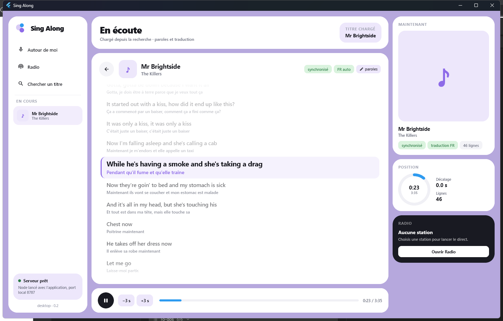
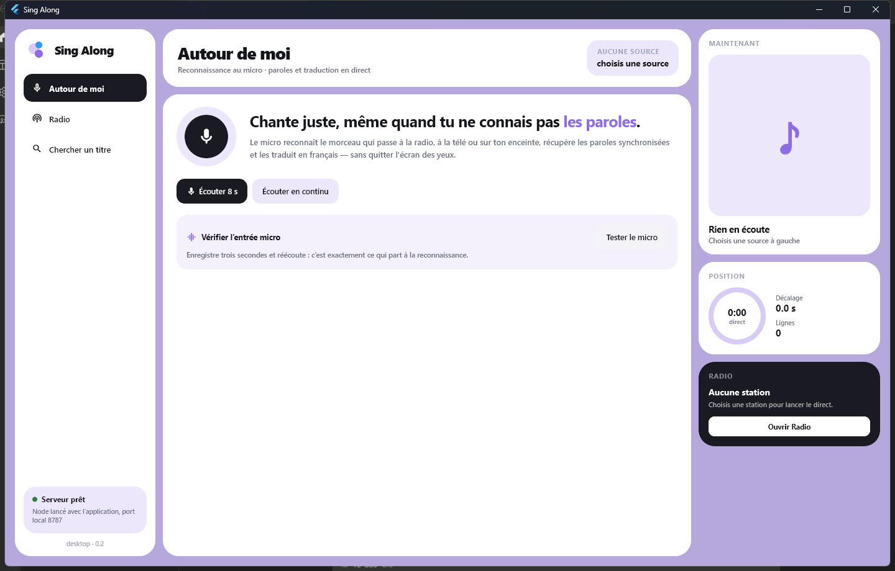
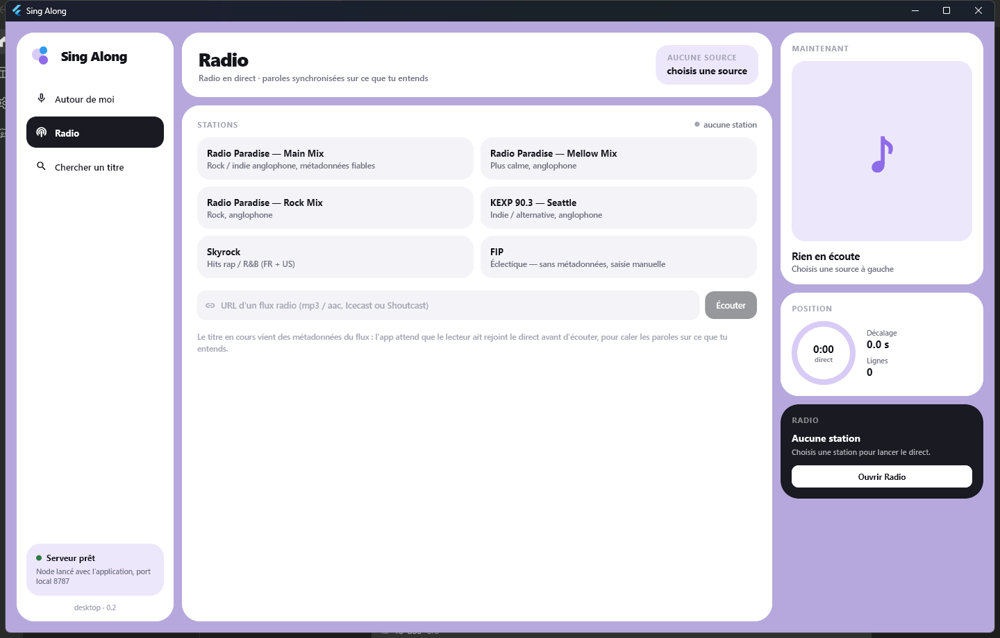

# Sing Along 🎤

Chante en écoutant la radio (ou n'importe quelle source) : l'app reconnaît le morceau en cours,
affiche **les paroles anglaises synchronisées** et **leur traduction française** en même temps.



Trois façons de l'utiliser :

| Mode | Ce que ça fait | Ce qu'il faut |
| --- | --- | --- |
| 🎤 **Autour de moi** | Le micro écoute 8 s, Shazam identifie le morceau, les paroles démarrent à l'endroit exact où tu en es | un micro |
| 📡 **Radio** | Connexion au flux, lecture des métadonnées ICY (`StreamTitle`), paroles du titre en cours, enchaînement automatique | une URL de flux Icecast/Shoutcast avec métadonnées |
| 🔎 **Chercher un titre** | Recherche manuelle pour répéter avant de chanter | rien |

## Démarrer

### Application desktop (Flutter) — l'app principale

Prérequis : **Node.js 20+** (pour le serveur) et **Flutter 3.47+** avec Visual Studio 2022 muni de la
charge de travail « Desktop development with C++ » (et le composant « C++ CMake tools for Windows »).
Le SDK Flutter doit être dans le `PATH` — `flutter doctor` doit répondre — sinon `npm run desktop`
ne trouvera pas la commande.

```bash
git clone https://github.com/cedpru/learn-english-by-singing
cd learn-english-by-singing

npm install                       # dépendances du serveur (express, shazam, transformers…)
cd desktop
flutter pub get
flutter run -d windows            # ouvre la fenêtre, le serveur démarre tout seul
```

Build d'un exécutable :

```bash
cd desktop
flutter build windows --release
./build/windows/x64/runner/Release/sing_along.exe
```

L'app **démarre le serveur elle-même** : elle le cherche en remontant depuis l'exécutable (ou via
`SINGALONG_ROOT=/chemin/du/projet`), lance `node` sur `server/index.ts` avec `tsx`, attend
`/api/health` puis affiche la fenêtre. Le serveur reçoit le PID de la fenêtre et s'arrête avec elle :
plus de `node` orphelin qui garde le port 8787. Un serveur déjà lancé (`npm run dev`) est réutilisé.

Un raccourci **Sing Along** (Bureau + menu Démarrer) pointe sur le build release : double-clic, la
fenêtre s'ouvre, le serveur démarre. Un raccourci Windows ordinaire suffit — pointe-le sur
`desktop\build\windows\x64\runner\Release\sing_along.exe` avec le dossier du projet comme dossier
de travail.

### Version web (héritée)

```bash
npm install
npm run dev          # API sur :8787 + interface sur http://127.0.0.1:5173
```

Production locale :

```bash
npm run build
npm start            # sert l'interface compilée et l'API sur http://127.0.0.1:8787
```

Aucune clé d'API n'est nécessaire. Le premier morceau télécharge le modèle de traduction (~120 Mo,
mis en cache dans `data/models`), ensuite tout tourne en local.

## Comment ça marche

```
micro ──► POST /api/recognize ──► Shazam (sans clé) ──► { artist, title, offset }
                                                        │
radio ──► ICY StreamTitle ──────────────────────────────┤
                                                        ▼
                                        POST /api/karaoke
                                          ├─ LRCLIB     → LRC synchronisé (+ <mot> si dispo)
                                          ├─ texte collé → LRC ou texte simple (paroles maison)
                                          └─ OPUS-MT    → traduction EN→FR (cache disque)
                                                        ▼
                               horloge de lecture → surlignage ligne/mot
```

- **Reconnaissance** — [`node-shazam`](https://github.com/scaranaraa/Node-Shazam) interroge l'API
  non officielle de Shazam (signature audio calculée en local, aucune clé). La réponse contient
  `matches[0].offset`, c'est-à-dire la position du clip dans le morceau : c'est ce qui permet de
  démarrer les paroles au bon endroit quand tu arrives en cours de chanson.
- **Paroles** — [LRCLIB](https://lrclib.net) (gratuit, sans clé) renvoie `syncedLyrics` au format
  LRC. Le parseur gère aussi le LRC « enrichi » avec timings par mot (`<00:12.34>`), rare mais géré.
  Le serveur refuse un résultat dont l'artiste ne correspond pas : mieux vaut « paroles introuvables »
  que les paroles d'une autre chanson.
- **Traduction** — [`Xenova/opus-mt-en-fr`](https://huggingface.co/Xenova/opus-mt-en-fr) exécuté par
  `@huggingface/transformers` en local. Une chanson n'est traduite qu'une fois, puis servie depuis
  `data/translations.json`. Détection de langue basique : les morceaux déjà en français ne sont pas
  traduits, les autres langues sont signalées comme « traduction approximative ».
- **Radio** — le serveur ouvre le flux avec `Icy-MetaData: 1`, saute l'audio par blocs de
  `icy-metaint` octets et lit le bloc `StreamTitle`. La date du changement de titre sert d'ancre
  pour caler l'horloge. Certaines stations n'annoncent rien d'exploitable : pas de métadonnées du
  tout (FIP) ou seulement leur propre nom (« DANCEBOX »). L'app le dit au lieu de laisser un écran
  vide, écoute alors le direct pour faire nommer le morceau par Shazam, et affiche la saisie
  manuelle en parallèle — elle reste le seul recours quand la reconnaissance échoue (DJ set,
  morceau rare).

### Lecture

Dans l'app desktop (Flutter), la radio est jouée par le moteur audio local (`media_kit` / mpv) et
les commandes pilotent le **vrai flux** : `❚❚` met la musique en pause et fige les paroles en même
temps, `▶` relance les deux. Raccourcis : `Ctrl+Espace` lecture/pause, `Ctrl+M` couper le son,
`Ctrl+←` / `Ctrl+→` décaler les paroles de 3 s, `Échap` revenir aux sources. Ils portent un
modificateur exprès : l'app est pleine de champs de texte où « m » et l'espace doivent rester des
lettres. Volume et corrections sont enregistrés dans `%APPDATA%\SingAlong\settings.json`.
Après une pause de plus de 10 s, un nouveau recalage Shazam est demandé automatiquement, parce qu'un
flux live repris peut sauter à l'edge et désaligner les paroles. En mode micro ou recherche, il n'y
a pas d'audio à piloter : le bouton ne commande que le chrono des paroles. (Dans la version web,
l'audio est celui de l'élément `<audio>` et les raccourcis sont les flèches et `M`.)

### Synchronisation — le point délicat

Les métadonnées ICY disent **quel** morceau passe, pas **où** on en est dans ce morceau. En radio,
l'app enregistre donc 8 s du flux (`ffmpeg -re`, lecture à vitesse réelle pour que l'ancre
corresponde à l'horloge) et demande à Shazam la position réelle. Mesure sur Radio Paradise :
position estimée 149,0 s contre 150,0 s mesurée indépendamment. On en soustrait aussi la latence du
lecteur (`buffered.end − currentTime`), pour que les paroles suivent ce que tu **entends** et non ce
que le serveur reçoit. En mode micro, c'est `matches[0].offset` de Shazam qui sert d'ancre.

Attention au **moment** de la capture : la métadonnée ICY annonce le titre suivant avant que tu ne
l'entendes (le lecteur tamponne plusieurs secondes). Capturer tout de suite revenait à reconnaître la
fin du morceau précédent, et l'app rechargeait l'ancien titre — décalage d'une chanson qui ne se
résorbait jamais. La capture attend donc la latence du lecteur plus deux secondes, et un résultat
qui désigne un titre affiché dans la minute précédente est ignoré (capture périmée).

Reste l'imprécision des LRC eux-mêmes (fichiers contributifs, souvent ±1–2 s). Deux gestes la
corrigent : cliquer la ligne en cours de chant, ou `−3s / +3s`. Le décalage obtenu est mémorisé par
titre et réappliqué aux écoutes suivantes (`Ctrl+←` / `Ctrl+→` en desktop, flèches dans le
navigateur). Un clic moins de 800 ms après le chargement est ignoré : la souris ne doit pas décaler
les paroles par accident quand l'écran vient de changer.

### Quand un titre n'a pas de paroles

LRCLIB ne couvre pas tout (sorties récentes, groupes coréens ou japonais, raretés). Deux chemins :

1. **Recherche** — si la recherche ne trouve rien, deux champs « Artiste / Titre » chargent quand
   même la scène, paroles vides, pour les saisir à la main.
2. **Coller** — `✎ paroles` ouvre un éditeur : colle le texte (une ligne par phrase) ou un LRC
   complet pour garder les timings. C'est enregistré sur l'appareil, par titre, et renvoyé à
   `/api/karaoke` à chaque chargement (`rawLyrics`), avec la traduction habituelle. L'app desktop
   ne propose pas (encore) l'import de fichier `.lrc` : il suffit d'ouvrir le fichier dans un éditeur
   et de coller son contenu.

   La version web garde aussi `⏱ Caler en rythme` (chaque `Entrée` horodate la ligne affichée) :
   ce mode n'a pas été porté sur Flutter. En desktop, un texte sans timings s'affiche en entier et
   `−3s / +3s` restent sans effet puisqu'il n'y a pas d'ancre horaire.

Le bouton `Retirer` supprime les paroles maison et revient à la recherche en ligne. Un titre dont
les paroles sont écrites dans une autre écriture que le latin (coréen, japonais, cyrillique…) est
affiché sans traduction : le modèle local ne sait faire que EN→FR, et mieux vaut pas de traduction
qu'une traduction inventée.

## Ce qui existe en open source (et pourquoi ces choix)

**Reconnaissance musicale**

| Projet | Licence | Usage | Verdict |
| --- | --- | --- | --- |
| Shazam via `node-shazam` / SongRec | GPL-2.0 | catalogue Shazam, sans clé | ✅ retenu : catalogue massif, 8 s suffisent |
| [Olaf](https://github.com/JorenSix/Olaf) | AGPL-3.0 | empreintes + index local, WASM possible | bon si l'on veut du 100 % local, mais il faut construire son propre catalogue |
| [Dejavu](https://github.com/worldveil/dejavu) / [audfprint](https://github.com/dpwe/audfprint) | MIT | DIY Python, catalogue maison | ~95 % à 2 s sur 45 titres dans le README, projets dormants (2020/2019) |
| [Chromaprint](https://github.com/acoustid/chromaprint) + AcoustID | MIT / service | fichiers quasi identiques, dédoublonnage | inadapté à la reconnaissance d'un extrait bruité |
| ACRCloud / AudD | propriétaire | API payante, catalogue + flux | ✅ la seule option robuste en production commerciale |

**Paroles** — LRCLIB (gratuit, synchronisé, sans clé) ✅ ; Musixmatch (synchronisé mais clé + licence) ;
Genius (pas de timings) ; lyrics.ovh (texte brut). Les paroles restent des œuvres protégées, quelle
que soit la licence du logiciel qui les sert.

**Traduction** — OPUS-MT EN→FR (~75 M paramètres, tourne dans le navigateur ou en Node) ✅ ;
NLLB-200 (meilleur multilingue mais 600 M et licence CC-BY-**NC**) ; LibreTranslate/Argos (AGPL) ;
DeepL / Google Translate (meilleurs en fluidité, mais clé + envoi des paroles à un tiers).

## Limites connues

- L'API Shazam utilisée n'est **pas officielle** : elle peut changer ou être bloquée. C'est un usage
  personnel, pas un service à revendre. SongRec signale par ailleurs que des brevets logiciels
  peuvent s'appliquer à ce type d'algorithme selon les juridictions.
- Couverture LRCLIB incomplète (beaucoup de titres récents/indés ont le texte mais pas les timings).
  Les timings par mot sont rares ; le surlignage mot à mot ne s'affiche que s'ils existent.
- En mode « Chercher un titre », l'app n'a **aucune source audio** : elle affiche les paroles et fait
defiler le chrono, mais le son vient de ta radio ou de ton lecteur. C'est le mode radio qui joue le flux.
- Un même titre existe en plusieurs exemplaires dans LRCLIB (vidéo, album, compilations) avec des
durées différentes : la liste n'en montre qu'un, choisi pour ressembler à la version radio/album.
- Les paroles ajoutées à la main restent locales (fichier `%APPDATA%\SingAlong\settings.json` en
  desktop, `localStorage` dans la version web) : elles ne sont ni synchronisées entre appareils, ni
  publiées vers LRCLIB.
- La traduction automatique est littérale : elle perd l'argot, les jeux de mots et les références,
  et elle n'existe pas pour les langues non latines.
- Une annonce « artiste — titre » fait toujours foi : Shazam ne la remplace jamais, il ne dit que
  **où** on en est dans le morceau. La reconnaissance ne sert de source du titre que lorsque
  l'annonce n'en contient aucun (nom de station seul ou pas de métadonnées), parce qu'elle s'est
  révélée trompeuse dans les cas observés : fin du morceau précédent, nom d'émission, DJ set. Elle
  échoue aussi régulièrement sur un mix continu : un flux dancefloor de test (×3 essais) n'a jamais
  été reconnu et il a fallu saisir le titre à la main. Certaines stations (KEXP) annoncent le nom de
  l'émission ; là, la saisie manuelle reste la seule voie.
- Le recalage automatique en radio coûte ~9 s (8 s d'écoute + reconnaissance) et une requête Shazam
  par morceau ; c'est une API non officielle, donc à ménager.
- Le mode micro exige un périphérique d'entrée. Sur le poste de test Windows il n'y en a **aucun** :
  l'app affiche alors « Aucun micro détecté sur cet appareil » au lieu de rester bloquée, mais la capture
  réelle (`record` → WAV → Shazam) n'a pas pu être vérifiée en conditions réelles. La chaîne serveur
  (WAV → ffmpeg → Shazam, offset correct) est validée sur un extrait réel de 8 s, et la version web
  validait la capture navigateur.
- Le navigateur applique un gain automatique (AGC) sur l'entrée : un silence n'affiche pas 0 %,
  d'où l'absence de verdict chiffré dans le test micro — la réécoute est la seule preuve fiable.

## Structure

```
server/
  index.ts        API Express (recognize, karaoke, search, radio) + veille du PID parent
  shazam.ts       reconnaissance + offset du clip (appels sérialisés)
  lyrics.ts       LRCLIB, parseur LRC, sélection du meilleur résultat
  translate.ts    OPUS-MT local + détection de langue + cache disque
  icy.ts          lecture des métadonnées ICY des flux radio
  presets.ts      stations avec métadonnées
desktop/          application Windows Flutter (l'app principale)
  lib/main.dart           démarrage, écran d'attente du serveur
  lib/server_launcher.dart  lance node/tsx, attend /api/health, tue le serveur à la fermeture
  lib/app_controller.dart   horloge des paroles, radio, recalage Shazam, micro
  lib/api.dart            client HTTP du serveur local
  lib/audio_engine.dart   lecture du flux (media_kit) + capture micro (record)
  lib/store.dart          volume, décalages et paroles maison (%APPDATA%)
  lib/ui/                 shell, thème flat, karaoké, panneaux micro/radio/recherche
src/              version web React (héritée, toujours fonctionnelle)
  App.tsx         orchestration des 3 sources + horloge
  components/     KaraokeStage, MicPanel, RadioPanel, SearchPanel
  hooks/          useSongClock, useMicRecorder, useRadio
  lib/            api, types, helpers LRC, paroles maison (localStorage)
```

## Design

Fenêtre claire en `flat design` : fond lavande, panneaux blancs à grands rayons, un seul carton
sombre (la radio), accent bleu et violet, aucune ombre ni dégradé. La barre latérale porte les
sources, la colonne de droite la pochette, la position (anneau) et l'état du direct, le centre les
paroles. Palette dans [`desktop/lib/ui/theme.dart`](desktop/lib/ui/theme.dart).

## Captures

| Accueil | Radio |
| --- | --- |
|  |  |

## Licences

Le code de l'app n'a pas encore de licence explicite : ajoute un fichier `LICENSE` (MIT par
exemple) avant de le redistribuer. Attention, `node-shazam` est **GPL-2.0** : si tu redistribues
l'ensemble, il faut respecter cette licence. Le serveur LRCLIB est MIT (les paroles, non),
`transformers.js` est Apache-2.0, le modèle OPUS-MT est publié en CC-BY 4.0.
